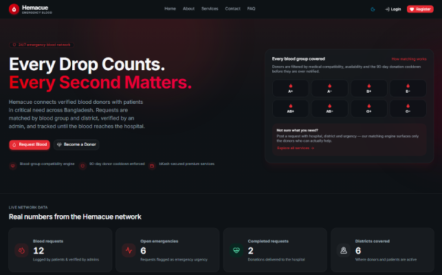

# 🩸 Hemacue — Emergency Blood Donation & Medical Logistics Platform

[](https://nextjs.org/)
[](https://react.dev/)
[](https://www.typescriptlang.org/)
[](https://tailwindcss.com/)
[](https://tanstack.com/query)
[](https://developer.bka.sh/)
[](https://biomejs.dev/)

> **Hemacue** is a modern, high-reliability emergency blood donation and medical logistics web platform built with Next.js 15 App Router, TypeScript, and Tailwind CSS. It bridges the critical gap between blood seekers (patients) and eligible donors through smart compatibility matching, real-time medical eligibility cooldown enforcement (90 days), automated workflow state machines, and integrated bKash Tokenized payments for premium logistics and notification services.

<!--- home page-image --->

<br/>

---

> ## **Live site**: [click here](https://hemacue-frontend.vercel.app/)

---

## 📋 Table of Contents

- [✨ Key Features](#-key-features)
- [🛠 Tech Stack & System Architecture](#-tech-stack--system-architecture)
- [Dependencies](#-dependencies)
- [📂 Comprehensive Project Structure](#-comprehensive-project-structure)
- [🌐 Backend API & Route Integration Matrix](#-backend-api--route-integration-matrix)
- [🔐 Authentication & Role-Based Security (RBAC)](#-authentication--role-based-security-rbac)
- [💳 bKash Payment & Invoice Workflow](#-bkash-payment--invoice-workflow)
- [🚀 Quick Start & Environment Setup](#-quick-start--environment-setup)
- [🔧 Development Scripts & Quality Control](#-development-scripts--quality-control)
- [📄 Documentation Links](#-documentation-links)

---

## ✨ Key Features

### 🩸 Patient & Blood Requester Workflow

- **Emergency & Standard Requests:** Create detailed blood requests specifying patient name, required blood group, hospital address, district, quantity, urgency, and deadline.
- **Smart Compatible Donor Matching:** Search eligible donors based on medical ABO/Rh blood compatibility rules while strictly excluding donors under the 90-day cooldown period.
- **Donor Assignment:** Directly assign compatible donors to blood requests and track response states (`PENDING`, `ACCEPTED`, `DECLINED`).
- **Guarded State Machine Lifecycle:** Track request progression through guarded statuses: <br/>
  PENDING > VERIFIED > DONOR_ASSIGNED > IN_PROGRESS > COMPLETED
- **bKash Logistics & Boosting:** Trigger bKash payments for premium SMS notification blasts and emergency courier logistics.

### 💖 Donor Portal

- **Available Requests Feed:** Browse active blood requests matching donor blood group and district location.
- **Match Response Actions:** One-click `ACCEPT` or `DECLINE` match assignments.
- **Donation History & Analytics:** Interactive charts tracking total donations, saved lives, and countdown timers until the next eligible donation date.
- **Profile & Availability Management:** Update profile details, upload avatar images to Cloudinary, and toggle donor availability status (`isAvailable`).

### 🛡 Admin Moderation & Audit Dashboard

- **Platform Analytics:** Real-time metrics on registered users, active blood requests, successful donations, and total BDT revenue.
- **User Management & RBAC:** Search and filter users by role (`DONOR`, `PATIENT`, `ADMIN`) or blood group, promote roles, and block/unblock accounts.
- **Blood Request Moderation & Refunds:** Moderate blood requests, reassign donors, soft-delete entries, and issue bKash transaction refunds.
- **System Audit Trails:** Paginated log inspection tool for tracking system actions, user updates, and administrative overrides.
- **Payments Ledger (`/admin/payments`):** Searchable, sortable payment list with status/type filters and bKash trxID copy-to-clipboard.
- **Analytics Page (`/admin/analytics`):** Donut and bar charts for request statuses, user roles, donation volumes and revenue (Recharts, lazy-loaded).
- **Settings Page (`/admin/settings`):** Read-only reference for cooldowns, urgency levels, blood groups and rate limits.

### 🏠 Home & Public Explore

- **10-Section Home Page:** Animated carousel hero (auto-advance, keyboard/touch navigation, reduced-motion aware) plus trust, services, featured-request, how-it-works, stats, testimonials, FAQ, CTA and footer sections.
- **Personalized Hero:** The first slide swaps headline and CTAs for the logged-in donor (open matches, cooldown state), patient (active requests) or anonymous visitor.
- **Featured Requests:** Server-rendered (ISR) grid of the six most urgent verified requests.
- **Public Explore Page (`/explore`):** Live request board with URL-synced search, blood-group/district/urgency filters and sorting — no login required.

### ✨ AI Features

- **AI Search Suggestions:** Category-tagged autocomplete (hospital, district, blood group, patient, transaction ID) in every table search box — deterministic prefix/word/substring/fuzzy scoring over on-screen rows.
- **AI Dashboard Insights:** Natural-language insight cards on the admin, patient and donor dashboards, derived purely from the data already loaded (pending verifications, revenue, cooldowns, pending invitations).
- **Dynamic Hero:** Role-aware hero copy generated by a pure `personalizeHero()` function — no external LLM required, swappable for one later.

### 🔐 Authentication & Role-Based Security (RBAC)

1. **HTTP-Only Cookies & Bearer Headers:** Authentication tokens (`accessToken`, `refreshToken`) are stored in secure HTTP-Only cookies to protect against XSS vectors, while also sent via `Authorization: Bearer <token>` headers for REST calls.
2. **Next.js Route Middleware (`middleware.ts`):** Intercepts incoming navigation requests to `/patient/*`, `/donor/*`, and `/admin/*`, ensuring users match required roles.
3. **Automatic Token Rotation:** The Axios interceptor (`src/lib/apiClient.ts`) listens for 401 response codes and transparently fetches a new access token via `/auth/refresh-token` before retrying failed queries.

### 💳 bKash Payment & Invoice Workflow

1. **Initiate (`POST /payments/initiate`):** Patients select premium SMS alerts (`PREMIUM_NOTIFICATION`) or courier logistics (`EMERGENCY_LOGISTICS`) on `/patient/requests/[id]`, generating a bKash checkout URL.
2. **bKash Sandbox/Production Checkout:** The user completes PIN/OTP verification on bKash's secure portal.
3. **Execute & Receipt (`POST /payments/execute`):** Upon redirection back to `/payment/callback`, the return token is executed, generating a downloadable PDF invoice and emailing a digital receipt.

---

## 🛠 Tech Stack & System Architecture

- **Framework:** Next.js 15 (App Router, Server Components, Route Handlers, ISR Revalidation)
- **Language:** TypeScript (Strict type safety across API contracts and component props)
- **State Management & Data Fetching:** TanStack Query v5 (React Query) for optimistic updates, automatic background refetching, and Query Cache key management
- **Styling & UI Primitives:** Tailwind CSS, Shadcn UI, Radix UI primitives, Lucide React icons, Framer Motion animations
- **Forms & Validation:** React Hook Form, Zod schema validation
- **Authentication:** JWT (HTTP-Only Cookies & Bearer Tokens), Google OAuth 2.0 Integration
- **Storage & Integrations:** Cloudinary (Avatar image uploads), bKash Tokenized Checkout API v1.2, Nodemailer (OTP emails & invoice attachments)
- **Formatting & Linting:** Biome.js, ESLint

---

## Dependencies

- [@base-ui/react](https://www.npmjs.com/package/@base-ui/react)
- [@react-oauth/google](https://www.npmjs.com/package/@react-oauth/google)
- [@tanstack/react-form](https://www.npmjs.com/package/@tanstack/react-form)
- [@tanstack/react-query](https://www.npmjs.com/package/@tanstack/react-query)
- [class-variance-authority](https://www.npmjs.com/package/class-variance-authority)
- [cn](https://www.npmjs.com/package/cn)
- [input-otp](https://www.npmjs.com/package/input-otp)
- [lucide-react](https://www.npmjs.com/package/lucide-react)
- [next](https://www.npmjs.com/package/next)
- [next-themes](https://www.npmjs.com/package/next-themes)
- [ofetch](https://www.npmjs.com/package/ofetch)
- [radix-ui](https://www.npmjs.com/package/radix-ui)
- [react](https://www.npmjs.com/package/react)
- [react-dom](https://www.npmjs.com/package/react-dom)
- [react-icons](https://www.npmjs.com/package/react-icons)
- [recharts](https://www.npmjs.com/package/recharts)
- [shadcn](https://www.npmjs.com/package/shadcn)
- [tw-animate-css](https://www.npmjs.com/package/tw-animate-css)
- [zod](https://www.npmjs.com/package/zod)
- [jsonwebtoken](https://www.npmjs.com/package/jsonwebtoken)

## 📂 Comprehensive Project Structure

Below is the exhaustive directory tree of the Hemacue frontend project (verified against the full source snapshot in [`project.txt`](./project.txt)):

```bash
hemacue-frontend/
├── public/                                # Static public assets
│   ├── file.svg                           # Default Next.js asset
│   ├── globe.svg                          # Default Next.js asset
│   ├── hemacue-image.png                  # README home-page screenshot
│   ├── next.svg                           # Default Next.js asset
│   ├── vercel.svg                         # Default Next.js asset
│   └── window.svg                         # Default Next.js asset
│
├── src/
│   ├── api/                               # Domain-based API client functions
│   │   ├── admin.api.ts                   # Admin users, payments, roles, dashboard stats & audit logs
│   │   ├── auth.api.ts                    # Registration, login, OTP, OAuth & password reset
│   │   ├── bloodRequest.api.ts            # Blood request CRUD, status transitions & donor response
│   │   ├── donorMatch.api.ts              # Donor matching, assignments & donation history
│   │   ├── index.ts                       # Central API exports
│   │   ├── payment.api.ts                 # bKash initiate/execute/refund & payment history
│   │   ├── public.api.ts                  # ISR fetch helpers: featured requests, explore listing, live stats
│   │   └── user.api.ts                    # Current user profile & avatar operations
│   │
│   ├── app/                               # Next.js App Router
│   │   ├── (dashboard)/                   # Authenticated dashboard route group
│   │   │   ├── admin/                     # Admin dashboard
│   │   │   │   ├── analytics/
│   │   │   │   │   └── page.tsx           # Donut & bar charts (Recharts, lazy-loaded)
│   │   │   │   ├── audit-logs/
│   │   │   │   │   └── page.tsx           # Audit log viewer & search
│   │   │   │   ├── blood-requests/
│   │   │   │   │   └── page.tsx           # Blood request moderation & status controls
│   │   │   │   ├── manage/
│   │   │   │   │   └── page.tsx           # User management & RBAC
│   │   │   │   ├── payments/
│   │   │   │   │   └── page.tsx           # Platform payments ledger
│   │   │   │   ├── settings/
│   │   │   │   │   └── page.tsx           # Read-only platform settings reference
│   │   │   │   ├── error.tsx              # Admin error boundary
│   │   │   │   ├── layout.tsx             # Admin dashboard layout
│   │   │   │   ├── loading.tsx            # Admin loading UI
│   │   │   │   └── page.tsx               # Admin overview + AI insight cards
│   │   │   │
│   │   │   ├── donor/                     # Donor dashboard
│   │   │   │   ├── analytics/
│   │   │   │   │   └── page.tsx           # Donation analytics & history charts
│   │   │   │   ├── profile/
│   │   │   │   │   └── page.tsx           # Donor profile & availability
│   │   │   │   ├── requests/
│   │   │   │   │   └── page.tsx           # Compatible open blood requests feed
│   │   │   │   ├── error.tsx              # Donor error boundary
│   │   │   │   ├── layout.tsx             # Donor dashboard layout
│   │   │   │   ├── loading.tsx            # Donor loading UI
│   │   │   │   └── page.tsx               # Donor dashboard overview
│   │   │   │
│   │   │   ├── patient/                   # Patient dashboard
│   │   │   │   ├── new/
│   │   │   │   │   └── page.tsx           # Create blood request wizard
│   │   │   │   ├── payments/
│   │   │   │   │   └── page.tsx           # Payment history
│   │   │   │   ├── profile/
│   │   │   │   │   └── page.tsx           # Patient profile
│   │   │   │   ├── requests/
│   │   │   │   │   └── [id]/
│   │   │   │   │       └── page.tsx       # Blood request details & donor matching
│   │   │   │   ├── error.tsx              # Patient error boundary
│   │   │   │   ├── layout.tsx             # Patient dashboard layout
│   │   │   │   ├── loading.tsx            # Patient loading UI
│   │   │   │   └── page.tsx               # Patient dashboard (requests overview + AI insights)
│   │   │   │
│   │   │   └── layout.tsx                 # Shared dashboard layout (RBAC guards)
│   │   │
│   │   ├── (public)/                      # Unauthenticated public routes
│   │   │   ├── about/
│   │   │   │   └── page.tsx               # About Hemacue
│   │   │   ├── blood-requests/
│   │   │   │   └── [id]/
│   │   │   │       └── page.tsx           # Public blood request detail page
│   │   │   ├── contact/
│   │   │   │   └── page.tsx               # Contact/support
│   │   │   ├── explore/
│   │   │   │   └── page.tsx               # Public live request board (server-fetched initial data)
│   │   │   ├── faq/
│   │   │   │   └── page.tsx               # Frequently asked questions
│   │   │   ├── forgot-password/
│   │   │   │   └── page.tsx               # Request password-reset OTP
│   │   │   ├── login/
│   │   │   │   └── page.tsx               # Login & Google OAuth
│   │   │   ├── register/
│   │   │   │   └── page.tsx               # User registration
│   │   │   ├── reset-password/
│   │   │   │   └── page.tsx               # Reset password
│   │   │   ├── services/
│   │   │   │   └── page.tsx               # Services overview
│   │   │   ├── verify-email/
│   │   │   │   └── page.tsx               # Email OTP verification
│   │   │   ├── layout.tsx                 # Public pages layout (Header/Footer)
│   │   │   └── page.tsx                   # Landing/home page (10 sections)
│   │   │
│   │   ├── api/                           # Next.js Route Handlers
│   │   │   └── auth/
│   │   │       └── session/
│   │   │           └── route.ts           # Auth session/cookie synchronization
│   │   │
│   │   ├── payment/                       # bKash payment result routes
│   │   │   ├── callback/
│   │   │   │   └── page.tsx               # Executes payment after bKash redirect
│   │   │   ├── cancel/
│   │   │   │   └── page.tsx               # Cancelled payment
│   │   │   ├── success/
│   │   │   │   └── page.tsx               # Successful payment & receipt
│   │   │   ├── error.tsx                  # Payment error boundary
│   │   │   ├── layout.tsx                 # Payment layout
│   │   │   └── loading.tsx                # Payment loading UI
│   │   │
│   │   ├── favicon.ico                    # Application favicon
│   │   ├── global-error.tsx               # Root-level error boundary
│   │   ├── globals.css                    # Global styles & Tailwind CSS
│   │   ├── layout.tsx                     # Root layout, metadata & providers
│   │   ├── loading.tsx                    # Global loading UI
│   │   └── not-found.tsx                  # 404 page
│   │
│   ├── components/                        # Reusable React components
│   │   ├── auth/                          # Authentication guards & states
│   │   │   ├── access-denied.tsx
│   │   │   ├── auth-guard.tsx
│   │   │   ├── auth-loading.tsx
│   │   │   └── role-guard.tsx
│   │   │
│   │   ├── dashboard/                     # Dashboard shell components
│   │   │   ├── dashboard-header.tsx
│   │   │   ├── dashboard-shell.tsx
│   │   │   ├── dashboard-sidebar.tsx
│   │   │   ├── route-error-fallback.tsx
│   │   │   ├── skeletons.tsx
│   │   │   └── theme-toggle.tsx
│   │   │
│   │   ├── layout/                        # Public/global layout components
│   │   │   └── public/
│   │   │       ├── Footer.tsx
│   │   │       ├── Header.tsx
│   │   │       ├── HeaderAuthActions.tsx
│   │   │       ├── HeaderNav.tsx
│   │   │       └── MobileNav.tsx
│   │   │
│   │   ├── modules/                       # Feature-specific UI components
│   │   │   ├── admin/                     # Admin dashboard modules
│   │   │   │   ├── analytics.tsx          # Analytics page composition (charts)
│   │   │   │   ├── audit-logs-table.tsx   # Audit logs table (AI search suggestions)
│   │   │   │   ├── blood-requests-table.tsx # Request moderation table (AI search, status quick-actions)
│   │   │   │   ├── donations-chart.tsx    # Donations bar chart
│   │   │   │   ├── overview.tsx           # Stats cards + AI insights + charts
│   │   │   │   ├── payments-table.tsx     # Payments ledger (AI search, trxID copy-to-clipboard)
│   │   │   │   ├── requests-chart.tsx     # Request status chart
│   │   │   │   ├── revenue-chart.tsx      # Revenue area chart
│   │   │   │   ├── users-chart.tsx        # User growth chart
│   │   │   │   └── users-table.tsx        # Users table with role/block actions (AI search)
│   │   │   │
│   │   │   ├── auth/                      # Auth forms
│   │   │   │   ├── demo-login-panel.tsx
│   │   │   │   ├── forgot-password-form.tsx
│   │   │   │   ├── login-form.tsx
│   │   │   │   ├── register-form.tsx
│   │   │   │   ├── reset-password-form.tsx
│   │   │   │   └── verify-email-form.tsx
│   │   │   │
│   │   │   ├── blood-requests/            # Blood request workflows
│   │   │   │   ├── create-request-wizard.tsx
│   │   │   │   ├── my-requests-table.tsx  # Patient's own requests (AI search suggestions)
│   │   │   │   ├── patient-insights.tsx   # AI insight cards for the patient dashboard
│   │   │   │   ├── patient-requests-overview.tsx
│   │   │   │   └── request-detail.tsx
│   │   │   │
│   │   │   ├── contact/
│   │   │   │   └── ContactForm.tsx
│   │   │   │
│   │   │   ├── donors/                    # Donor portal modules
│   │   │   │   ├── analytics-charts.tsx
│   │   │   │   ├── my-donations-table.tsx # Donation history + ACCEPT/DECLINE (AI search)
│   │   │   │   ├── open-requests-table.tsx # Compatible requests feed (AI search suggestions)
│   │   │   │   └── overview.tsx           # Donor dashboard + AI insights
│   │   │   │
│   │   │   ├── explore/                   # Public explore page
│   │   │   │   └── explore-client.tsx     # URL-synced filters + AI search suggestions
│   │   │   │
│   │   │   ├── faq/
│   │   │   │   └── FaqAccordion.tsx
│   │   │   │
│   │   │   ├── google-login/
│   │   │   │   └── GoogleLogin.tsx
│   │   │   │
│   │   │   ├── homepage/                  # Landing page sections
│   │   │   │   ├── FaqPreview.tsx
│   │   │   │   ├── FeaturedRequests.tsx
│   │   │   │   ├── Features.tsx
│   │   │   │   ├── Hero.tsx               # Role-aware personalized hero (personalizeHero)
│   │   │   │   ├── HowItWorks.tsx
│   │   │   │   ├── LiveStats.tsx
│   │   │   │   ├── PartnerHospitals.tsx
│   │   │   │   ├── Testimonials.tsx
│   │   │   │   └── TrustStrip.tsx
│   │   │   │
│   │   │   ├── payments/                  # Payment modules
│   │   │   │   ├── payment-history-table.tsx
│   │   │   │   └── payment-result.tsx
│   │   │   │
│   │   │   └── user/                      # Profile modules
│   │   │       ├── avatar-dropzone.tsx
│   │   │       └── profile-form.tsx
│   │   │
│   │   ├── shared/                        # Shared application components
│   │   │   ├── ai-insight-list.tsx        # AI insight cards (tone icons, action links)
│   │   │   ├── ai-search-input.tsx        # Search box + category-tagged suggestion dropdown
│   │   │   ├── bar-metric-chart.tsx
│   │   │   ├── blood-group-badge.tsx
│   │   │   ├── chart-card.tsx
│   │   │   ├── cta-section.tsx
│   │   │   ├── data-table-shell.tsx
│   │   │   ├── donut-chart.tsx
│   │   │   ├── empty-state.tsx
│   │   │   ├── filter-select.tsx
│   │   │   ├── hemacue-logo.tsx
│   │   │   ├── listing-card.tsx
│   │   │   ├── listing-grid.tsx
│   │   │   ├── page-heading.tsx
│   │   │   ├── page-hero.tsx
│   │   │   ├── pagination-bar.tsx
│   │   │   ├── search-input.tsx
│   │   │   ├── section-heading.tsx
│   │   │   ├── sortable-header.tsx
│   │   │   ├── stat-card.tsx
│   │   │   ├── status-badge.tsx
│   │   │   ├── urgency-badge.tsx
│   │   │   └── utility-page.tsx
│   │   │
│   │   └── ui/                            # Reusable Shadcn/Base UI primitives
│   │       ├── accordion.tsx
│   │       ├── alert-dialog.tsx
│   │       ├── alert.tsx
│   │       ├── avatar.tsx
│   │       ├── badge.tsx
│   │       ├── button.tsx
│   │       ├── card.tsx
│   │       ├── checkbox.tsx
│   │       ├── dialog.tsx
│   │       ├── dropdown-menu.tsx
│   │       ├── field.tsx
│   │       ├── input-otp.tsx
│   │       ├── input.tsx
│   │       ├── label.tsx
│   │       ├── pagination.tsx
│   │       ├── separator.tsx
│   │       ├── sheet.tsx
│   │       ├── sidebar.tsx
│   │       ├── skeleton.tsx
│   │       ├── spinner.tsx
│   │       ├── table.tsx
│   │       ├── tabs.tsx
│   │       ├── textarea.tsx
│   │       ├── toast.tsx
│   │       └── tooltip.tsx
│   │
│   ├── hooks/                             # TanStack Query & reusable custom hooks
│   │   ├── admin.hook.ts                  # useAdminUsers, useAdminPayments, useUpdateUserRole, useDashboardStats, useAuditLogs
│   │   ├── auth.hook.ts                   # Login, OAuth, registration, OTP, password & logout hooks
│   │   ├── bloodRequest.hook.ts           # Blood request CRUD, status transition & respond hooks
│   │   ├── donorMatch.hook.ts             # useCompatibleDonors, useAssignDonor, useMyDonations
│   │   ├── index.ts                       # Barrel export for all hooks
│   │   ├── payment.hook.ts                # useInitiatePayment, useExecutePayment, useRefundPayment, usePayment, useMyPayments
│   │   ├── use-ai-suggestions.ts          # Ranks a SuggestionIndex for a query (memoized)
│   │   ├── use-copy-to-clipboard.ts
│   │   ├── use-countdown.ts
│   │   ├── use-debounce.ts
│   │   ├── use-mobile.ts
│   │   ├── use-search-params-state.ts     # URL-synced key/value state
│   │   ├── use-table-state.ts             # Pagination/sort/filter/search facade over the URL
│   │   └── user.hook.ts                   # useGetMe, useUpdateProfile, useUploadAvatar
│   │
│   ├── lib/                               # Core utilities & application infrastructure
│   │   ├── ai/                            # Deterministic AI feature modules (no external LLM)
│   │   │   ├── hero-slice.ts              # personalizeHero() — role-aware hero copy
│   │   │   ├── insights.ts                # generateAdmin/Patient/DonorInsights()
│   │   │   ├── levenshtein.ts             # Two-row edit-distance implementation
│   │   │   ├── suggestion-index.ts        # buildSuggestionIndex() from on-screen rows
│   │   │   └── suggestions.ts             # Categories, scoring & rankSuggestions()
│   │   ├── apiClient.ts                   # ofetch-based API client (401 refresh logic)
│   │   ├── auth-cookies.ts                # Authentication cookie constants/helpers
│   │   ├── blood-compatibility.ts         # Blood compatibility rules & 90-day cooldown
│   │   ├── chart-buckets.ts               # Week/month axis bucketing for charts
│   │   ├── constants.ts                   # Application constants & enums
│   │   ├── dashboard-chart-data.ts        # Dashboard chart series builders
│   │   ├── format.ts                      # Date/currency/token + Intl axis formatters
│   │   ├── query-keys.ts                  # TanStack Query key factories
│   │   ├── session-client.ts              # Client-side session/token synchronization
│   │   └── utils.ts                       # cn() and shared helpers
│   │
│   ├── providers/                         # React context / application providers
│   │   ├── google-auth.provider.tsx       # Google OAuth provider
│   │   ├── index.tsx                      # Combined providers entry point
│   │   ├── query.provider.tsx             # TanStack Query provider
│   │   └── theme.provider.tsx             # Dark/light theme provider
│   │
│   ├── routes/                            # Dashboard navigation configuration
│   │   ├── admin.routes.ts
│   │   ├── donor.routes.ts
│   │   ├── index.ts
│   │   └── patient.routes.ts
│   │
│   ├── service/                           # Server-side application services
│   │   └── refreshToken.ts                # Refresh-token service
│   │
│   ├── types/                             # TypeScript types & API contracts
│   │   ├── admin.type.ts
│   │   ├── api.type.ts
│   │   ├── auth.type.ts
│   │   ├── blood-request.type.ts
│   │   ├── donor-match.type.ts
│   │   ├── enums.type.ts
│   │   ├── index.ts
│   │   ├── payment.type.ts
│   │   ├── public.type.ts
│   │   ├── sidebar.type.ts
│   │   └── user.type.ts
│   │
│   ├── utils/                             # Small specialized utilities
│   │   └── jwt.ts                         # JWT decoding helpers
│   │
│   ├── validation/                        # Zod validation schemas
│   │   ├── admin.validation.ts
│   │   ├── auth.validation.ts
│   │   ├── blood-request.validation.ts
│   │   ├── contact.validation.ts
│   │   ├── index.ts
│   │   ├── payment.validation.ts
│   │   └── user.validation.ts
│   │
│   └── proxy.ts                           # Next.js request proxy — RBAC route guards
│
├── .env.example                           # Environment variable template
├── API-overview-hemacue-backend.md        # Backend REST API specification (33 endpoints + health route)
├── biome.json                             # Biome formatter & linter configuration
├── components.json                        # Shadcn UI configuration
├── hemacue-api-map.md                     # Frontend ↔ backend API integration matrix
├── hemacue-frontend-project-requirement.md # Project requirement brief
├── next-env.d.ts                          # Next.js TypeScript declarations
├── next.config.ts                         # Next.js configuration
├── package.json                           # Dependencies, scripts & package manager
├── pnpm-lock.yaml                         # pnpm lockfile
├── postcss.config.mjs                     # PostCSS/Tailwind configuration
├── README.md                              # This file
├── tsconfig.json                          # TypeScript compiler configuration
├── tsconfig.tsbuildinfo                   # TypeScript incremental build information
├── vercel.json                            # Vercel deployment configuration

```

> Build artifacts (`node_modules/`, `.next/`, `.git/`), local secrets (`.env.local`) and the backend's dependencies are omitted for brevity.

---

## 🌐 Backend API & Route Integration Matrix

For complete technical details on how all **33 backend REST API endpoints** (plus the unauthenticated health route `GET /`) map to Next.js routes and React Query hooks, view the [`hemacue-api-map.md`](./hemacue-api-map.md) specification file.

| Module      | Method   | Endpoint                                  | Frontend Route                                              | Hook / API Client                  | Access Level           |
| :---------- | :------- | :---------------------------------------- | :---------------------------------------------------------- | :--------------------------------- | :--------------------- |
| **Auth**    | `POST`   | `/api/v1/auth/register`                   | `/register`                                                 | `useRegistration()`                | Public                 |
| **Auth**    | `POST`   | `/api/v1/auth/verify-email`               | `/verify-email`                                             | `useVerifyAccount()`               | Public                 |
| **Auth**    | `POST`   | `/api/v1/auth/verify-email/resend-otp`    | `/verify-email`                                             | `useResendRegisterOtp()`           | Public                 |
| **Auth**    | `POST`   | `/api/v1/auth/login`                      | `/login`                                                    | `useLogin()`                       | Public                 |
| **Auth**    | `POST`   | `/api/v1/auth/refresh-token`              | Internal Interceptor                                        | `authApi.refreshToken`             | Public / Cookie        |
| **Auth**    | `POST`   | `/api/v1/auth/google-login`               | `/login`, `/register`                                       | `useGoogleOAuth()`                 | Public                 |
| **Auth**    | `POST`   | `/api/v1/auth/forgot-password`            | `/forgot-password`                                          | `useForgotPassword()`              | Public                 |
| **Auth**    | `POST`   | `/api/v1/auth/reset-password`             | `/reset-password`                                           | `useResetPassword()`               | Public                 |
| **Auth**    | `POST`   | `/api/v1/auth/logout`                     | Header / Sidebar                                            | `useLogout()`                      | Authenticated          |
| **User**    | `GET`    | `/api/v1/users/me`                        | Profile pages & dashboards                                  | `useGetMe()`                       | DONOR, PATIENT, ADMIN  |
| **User**    | `PATCH`  | `/api/v1/users/me`                        | `/donor/profile`, `/patient/profile`                        | `useUpdateProfile()`               | DONOR, PATIENT, ADMIN  |
| **User**    | `PATCH`  | `/api/v1/users/me/avatar`                 | `/donor/profile`, `/patient/profile`                        | `useUploadAvatar()`                | DONOR, PATIENT, ADMIN  |
| **Request** | `POST`   | `/api/v1/blood-requests`                  | `/patient/new`                                              | `useCreateBloodRequest()`          | PATIENT, ADMIN         |
| **Request** | `GET`    | `/api/v1/blood-requests`                  | `/`, `/explore`, `/donor/requests`, `/admin/blood-requests` | `useBloodRequests()` / `publicApi` | Public / Admin         |
| **Request** | `GET`    | `/api/v1/blood-requests/my-requests`      | `/patient`                                                  | `useMyBloodRequests()`             | PATIENT, ADMIN         |
| **Request** | `GET`    | `/api/v1/blood-requests/:id`              | `/patient/requests/[id]`, `/blood-requests/[id]`            | `useBloodRequest()`                | Public / Authenticated |
| **Request** | `PATCH`  | `/api/v1/blood-requests/:id`              | — (hook ready, UI not wired)                                | `useUpdateBloodRequest()`          | PATIENT, ADMIN         |
| **Request** | `DELETE` | `/api/v1/blood-requests/:id`              | — (hook ready, UI not wired)                                | `useDeleteBloodRequest()`          | PATIENT, ADMIN         |
| **Donor**   | `GET`    | `/api/v1/donor-matches/compatible-donors` | `/patient/requests/[id]`, `/blood-requests/[id]`            | `useCompatibleDonors()`            | PATIENT, ADMIN         |
| **Donor**   | `POST`   | `/api/v1/donor-matches/assign-donor`      | `/patient/requests/[id]`, `/blood-requests/[id]`            | `useAssignDonor()`                 | PATIENT, ADMIN         |
| **Donor**   | `POST`   | `/api/v1/blood-requests/:id/respond`      | `/donor`                                                    | `useRespondToRequest()`            | DONOR                  |
| **Donor**   | `PATCH`  | `/api/v1/blood-requests/:id/status`       | `/patient/requests/[id]`, `/admin/blood-requests`           | `useUpdateRequestStatus()`         | PATIENT, ADMIN         |
| **Donor**   | `GET`    | `/api/v1/donor-matches/my-donations`      | `/donor`, `/donor/analytics`                                | `useMyDonations()`                 | DONOR                  |
| **Payment** | `POST`   | `/api/v1/payments/initiate`               | `/patient/requests/[id]`                                    | `useInitiatePayment()`             | PATIENT, ADMIN         |
| **Payment** | `POST`   | `/api/v1/payments/execute`                | `/payment/callback`                                         | `useExecutePayment()`              | PATIENT, ADMIN         |
| **Payment** | `POST`   | `/api/v1/payments/refund/:requestId`      | — (hook ready, UI not wired)                                | `useRefundPayment()`               | ADMIN                  |
| **Payment** | `GET`    | `/api/v1/payments/mine`                   | `/patient/payments`                                         | `useMyPayments()`                  | PATIENT, ADMIN         |
| **Payment** | `GET`    | `/api/v1/payments/:id`                    | — (hook ready, UI not wired)                                | `usePayment()`                     | PATIENT, ADMIN         |
| **Admin**   | `GET`    | `/api/v1/admin/users`                     | `/admin/manage`                                             | `useAdminUsers()`                  | ADMIN                  |
| **Admin**   | `GET`    | `/api/v1/admin/payments`                  | `/admin/payments`, `/admin/analytics`                       | `useAdminPayments()`               | ADMIN                  |
| **Admin**   | `PATCH`  | `/api/v1/admin/users/:id/role`            | `/admin/manage`                                             | `useUpdateUserRole()`              | ADMIN                  |
| **Admin**   | `GET`    | `/api/v1/admin/dashboard-stats`           | `/admin`, `/admin/analytics`                                | `useDashboardStats()`              | ADMIN                  |
| **Admin**   | `GET`    | `/api/v1/admin/audit-logs`                | `/admin/audit-logs`                                         | `useAuditLogs()`                   | ADMIN                  |

---

## 🚀 Quick Start & Environment Setup

### Prerequisites

- **Node.js**: `v18.x` or higher
- **Backend API**: Running instance of Hemacue Backend (default: `http://localhost:5000/api/v1`)

### 1. Clone & Install frontend and backend

```bash
git clone https://github.com/forhad823/hemacue-frontend-a7b7.git
cd hemacue-frontend
pnpm install

git clone https://github.com/forhad823/hemacue-backend-A6-B7.git
cd hemacue-backend
npm install

```

### 2. Configure Environment Variables (`.env.local`)

```env
# Backend REST API URL
NEXT_PUBLIC_API_BASE_URL=http://localhost:5000/api/v1

# Google OAuth Client ID
NEXT_PUBLIC_GOOGLE_CLIENT_ID=your-google-client-id.apps.googleusercontent.com

# Frontend Site URL
NEXT_PUBLIC_SITE_URL=http://localhost:3000

# Or you can use https://hemacue-backend.vercel.app/   instead of
http://localhost:5000
```

### 3. Run Development Server

```bash
npm run dev
```

Open [http://localhost:3000](http://localhost:3000) in your browser.

---

## 🔧 Development Scripts & Quality Control

| Command          | Purpose                                                      |
| :--------------- | :----------------------------------------------------------- |
| `npm run dev`    | Starts Next.js development server on `http://localhost:3000` |
| `npm run build`  | Compiles production build and optimizes routes               |
| `npm run start`  | Launches production server                                   |
| `npm run lint`   | Runs Biome & ESLint code quality checks                      |
| `npm run format` | Auto-formats code with Biome                                 |

---

## 📄 Documentation Links

- [Frontend to Backend API Map (`hemacue-api-map.md`)](./hemacue-api-map.md)
- [Hemacue Backend API Overview](./API-overview-hemacue-backend.md)
